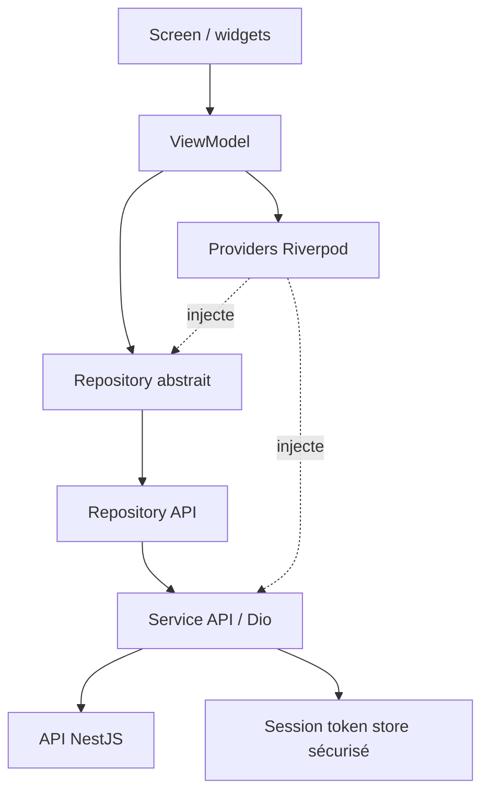

# Architecture de l’application mobile IMOVIA

## Décision

Application Flutter en **MVVM par fonctionnalité**, avec séparation UI/données, repositories comme sources de vérité, services API isolés et injection de dépendances Riverpod. Cette structure suit les recommandations Flutter de séparation des responsabilités, ViewModels, repositories abstraits et tests avec fakes. La couche domaine reste légère : pas de use case pour un simple appel CRUD ; on en ajoute pour les règles de publication ou les autres workflows réellement complexes.



## Structure cible

```text
lib/
  app/                  # MaterialApp, providers, router, configuration
  core/
    network/            # Dio, configuration d’environnement, erreurs API
    security/           # stockage sécurisé du jeton de session
    theme/              # couleurs, typographie, espacements, rayons, thèmes
    ui/                 # composants réutilisables validés
    utils/              # format FCFA, dates, validation commune
  features/
    auth/{data,domain,presentation}/
    catalog/{data,domain,presentation}/
    search/{data,domain,presentation}/
    property/{data,domain,presentation}/
    favorites/{data,domain,presentation}/
    notifications/{data,domain,presentation}/
    profile/{data,domain,presentation}/
    publisher/{data,domain,presentation}/
```

Chaque feature possède ses écrans, ViewModels, modèles et repositories. Les widgets métiers restent dans leur feature ; seuls les composants génériques partent dans `core/ui`.

## Règles de conception du code

- Un écran affiche un état et transmet les actions au ViewModel ; il ne construit pas directement les requêtes HTTP.
- Un ViewModel expose des états immuables et les actions de l’écran. Les chargements utilisent des états `loading`, `data`, `empty` et `error`.
- Une interface de repository sépare le contrat métier de l’API ; un fake remplace le repository en test.
- Les DTO API sont convertis en modèles mobiles typés dans la couche données. Pas de génération de code dans le socle MVP : le nombre actuel de modèles ne justifie pas le temps de génération et de maintenance supplémentaire.
- Riverpod sert à l’état réactif et à l’injection ; `go_router` porte les routes nommées, liens profonds et redirections après authentification.
- Dio est créé une fois par application, avec délais bornés et erreurs converties en erreurs métier sûres. Pas de journalisation d’en-têtes ou de jetons en production.
- Le jeton bearer est conservé dans Keychain/Keystore via `flutter_secure_storage`. OTP et secrets ne vont ni dans `SharedPreferences`, ni dans les logs.
- Les appels vers le stockage objet utilisent un client distinct de l’API pour qu’un jeton bearer ne soit jamais ajouté à une URL présignée.
- `API_BASE_URL` est une variable de compilation. Défaut Android émulateur : `http://10.0.2.2:3000/api/`; iOS simulateur : `http://127.0.0.1:3000/api/`. Les environnements déployés utilisent HTTPS.
- Le panier réseau ne télécharge pas d’images de fond. Les images de biens apparaissent uniquement dans les cartes et galeries prévues pour elles.

## Dépendances retenues

- `material_ui` : composants Material officiels désormais distribués comme package Flutter.
- `flutter_riverpod` : ViewModels réactifs, états asynchrones et injection testable.
- `go_router` : navigation déclarative et redirections après OTP.
- `dio` : client API partagé, délais, annulation et progression des téléversements.
- `flutter_secure_storage` : jeton de session chiffré par le système.
- `intl` : format monétaire FCFA et dates localisées.

La galerie/photo (sélecteur, réduction avant envoi et client de téléversement) sera ajoutée au lot AN-05 ; partage et ouverture téléphone/WhatsApp au lot CH-04/CH-06. Cela évite d’embarquer ces dépendances tant que les écrans correspondants ne sont pas commencés.

## Tests par lot

Avant de passer au lot suivant :

1. tests unitaires DTO, service/repository et ViewModel ;
2. tests widget des états de la page et de ses actions principales ;
3. vérification API avec fakes au niveau Flutter, puis parcours API réel sur l’environnement local lorsque le lot le nécessite ;
4. `flutter analyze` et `flutter test` verts.

Les textes finaux sont fournis et validés page par page. Aucun texte de maquette n’est figé par le socle technique.

## Typographie à fournir

Le design system déclare Inter/Manrope et sa planche affiche Plus Jakarta Sans, mais les fichiers de police sont absents du dépôt et les chemins CSS pointent encore vers l’ancien dossier `apps/web`. Le thème Flutter ne télécharge donc aucune police à l’exécution. Avant la première page, il faudra choisir la famille finale et ajouter ses fichiers locaux sous `apps/mobile/assets/fonts/`.
